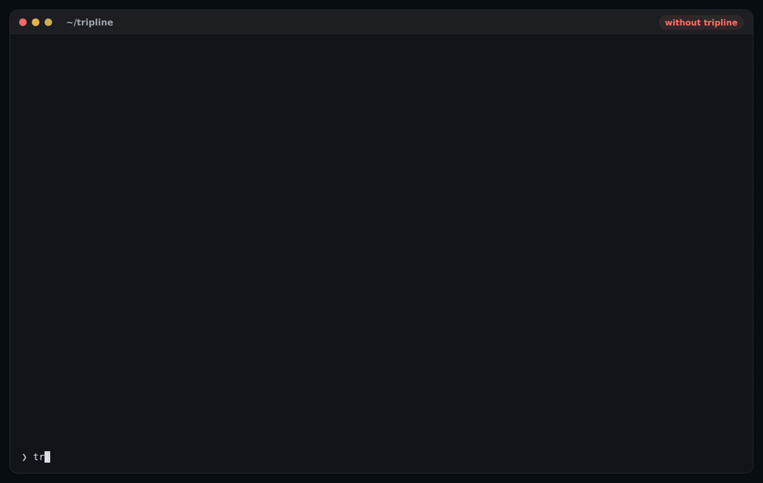
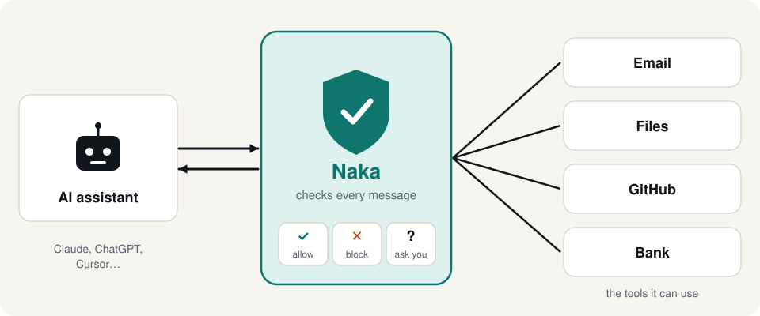

<p align="center">
  <picture>
    <source media="(prefers-color-scheme: dark)" srcset="docs/img/brand/wordmark-dark.svg">
    
  </picture>
</p>

<p align="center"><b>The open-source runtime firewall for AI agents.</b><br>
Stops poisoned tools, rug-pulls, data theft, AI worms and memory poisoning in the live traffic between your agent and its MCP servers.</p>

<p align="center">
  <a href="https://github.com/lakshyab20/tripline/actions/workflows/ci.yml"></a>
  <a href="LICENSE"></a>
  
  
  <a href="docs/SCOREBOARD.md"></a>
</p>

<p align="center">
  <a href="#get-started">Get started</a> ·
  <a href="docs/EXPLAINED.md">Explained simply</a> ·
  <a href="docs/SCOREBOARD.md">Scoreboard</a> ·
  <a href="docs/EVALS.md">Test any guard</a> ·
  <a href="docs/ARCHITECTURE.md">Architecture</a> ·
  <a href="CONTRIBUTING.md">Contribute</a>
</p>

---

AI agents do whatever the text they read tells them, including a note an attacker hid in an email, a web page or a GitHub issue. And they hold the keys to your email, files, code and money. Tripline sits between the agent (Claude, Cursor, VS Code, any MCP client) and its tools, and checks every message both ways:

```
 AI agent  ⇄  tripline  ⇄  MCP servers
 (Claude,     checks         (GitHub, Slack, files, mail,
  Cursor...)  every message   or a remote https:// server)
```

- 🔒 **Follows your secrets.** A key read through one tool can't leave through another, even base64-encoded, reversed or split up.
- 🪱 **Stops AI worms.** An injected note can't be copied into emails, comments or chats where the next AI will read it. *We haven't found another MCP guard that does this.*
- 🧠 **Protects the AI's memory.** Attacker text can't be written into CLAUDE.md, AGENTS.md, Cursor rules, skills or a memory server, where it would come back every session.
- 📌 **Pins every tool.** A tool that changes after you approved it is quarantined.
- 🙋 **Asks you, in the app.** Payments, unlocks and messages to addresses the agent just read pop up a question instead of a guess.

It fails closed, has zero dependencies, and sets up with one command.

<p align="center"></p>

## Get started

```bash
pip install git+https://github.com/lakshyab20/tripline   # PyPI release coming
tripline install --dry-run      # see which servers in Claude/Cursor/VS Code/... would be protected
tripline install                # protect them (backs up each config; `tripline uninstall` restores)
```

Restart the apps. Every MCP server now runs through Tripline. To see it work first:

```bash
tripline demo --unprotected   # a hijacked agent, two servers: 7 attacks succeed
tripline demo                 # the same agent through Tripline: every one is stopped
```

## In plain words



New to AI agent security? **[Tripline explained simply, in six pictures →](docs/EXPLAINED.md)**

## Scoreboard

Same 40 attacks and 22 everyday tasks, through each guard, scored by what actually reached the tools ([details and caveats](docs/SCOREBOARD.md)):

| Guard | Classic MCP attacks stopped | AI worms and memory poisoning stopped | Everyday tasks interrupted |
|---|---:|---:|---:|
| No guard | 0 / 13 | 0 / 27 | 0 / 22 |
| **Tripline** | **13 / 13** | **27 / 27** | 4 / 22 |
| Pipelock 3.7.1 (`claude-code` and `strict` presets) | 10 / 13 | 0 / 27 | 1 / 22 |

The suites are ours and include attack families other guards don't claim to cover, so read the [per-kind breakdown](docs/SCOREBOARD.md). Pipelock does plenty this test doesn't measure (an HTTP egress proxy, signed receipts). Run it yourself, or add your guard:

```bash
tripline eval --guard tripline --guard "yourguard=yourguard proxy -- {cmd}" -v
```

## What it stops

| Attack | What happens | Tripline's rule |
|---|---|---|
| **Tool poisoning** | A tool's description hides instructions for the model, often in invisible Unicode | `poisoned-tool`: hidden from the agent, calls refused |
| **Rug-pull** | A tool is harmless when you approve it, then changes later | `rug-pull`: every definition is pinned by SHA-256; a change is quarantined |
| **Indirect prompt injection** | Tool output (a page, an issue, an email) tells the model what to do | `injected-response`: withheld, or labelled as untrusted in warn mode |
| **Injected destinations** | The output says "email this to attacker@…" or "transfer to account …" and the agent does it | `untrusted-destination`: an address, URL, account or ID that came from tool output can't decide where data goes without your OK |
| **Data theft** | A secret read through one server leaves through another | `tainted-flow`: tracked across every server in the app, even base64-encoded, reversed, reformatted or split up |
| **High-impact actions** | After reading untrusted content, the agent pays, unlocks, grants access or deletes | `after-untrusted`: asks you first |
| **AI worms** | A hijacked agent copies an injected note into an email reply, a forward, an issue comment, a code comment or team chat, where the next AI reads it and spreads it further | `spread`: Tripline remembers the wording of everything untrusted tools return; a copied note that asks to be passed on can't leave, in several languages, even edited or buried in padding |
| **Memory poisoning** | The note is written into CLAUDE.md, AGENTS.md, Cursor/Cline/Windsurf rules, skills, a memory server, an MCP config, a git hook or a CI workflow, so it comes back every session | `memory-poisoning` / `memory-write`: copied text with a link, command or AI-directed request is blocked; other outside text asks first. Text from your own project files is fine |
| **Credential leaks** | API keys, tokens or private keys in tool-call arguments | `secret-in-args` |
| **Look-alike tools** | A new tool named `send_emaіl` (Cyrillic і) shadows `send_email` | `shadow-tool` |

Detection covers hidden Unicode, base64, look-alike letters, English plus Hindi/Hinglish, Spanish, French, German and Portuguese phrasings, common credentials, and India-aware PII (PAN, Aadhaar, Luhn-checked card numbers).

## Measured, not claimed

**`tripline eval`** runs attack scenarios and everyday tasks through *any* MCP guard over real stdio, and scores what actually reached the tools ([how it works](docs/EVALS.md)). It includes the first open test set for AI worms and memory poisoning, with everyday look-alikes (quoting, forwarding, saving notes) that a guard must let through.

| Suite | No guard: attacks stopped | Tripline: attacks stopped | Tripline: everyday tasks interrupted |
|---|---:|---:|---:|
| `contagion` (AI worms, memory poisoning) | 0 / 27 | **27 / 27** | 1 / 15¹ |
| `mcp-attacks` (poisoning, rug-pulls, theft, injected actions) | 0 / 13 | **13 / 13** | 3 / 7² |
| `injecagent` (1,054 public cases) | 0% | **82.3%** | 24.3%³ |

¹ Saving text from an email into the AI's long-term memory asks first. ² A reply to an address read from an email and paying a bill from a list ask first; copying `.env` into another file is blocked. ³ Every one is a high-impact action (payment, unlock, access grant…) right after reading outside content: a confirmation click, not a block. On 924 real emails, documents and code snippets copied into outgoing messages, the spread rule fired on 0 (block) and 0.3% (ask).

**Replaying 1,054 InjecAgent attacks end to end** (a fully hijacked agent tries to complete each attack):

| Configuration | Direct harm stopped | Data theft stopped | Legitimate runs interrupted |
|---|---:|---:|---:|
| Detection only (regex) | 0% | 1.7% | 0% |
| Data-flow rules, destinations only | 36.7% | **100%** | 1.7% |
| **Default** (+ ask before high-impact actions) | **63.3%** | **100%** | 24.3% |
| Strict (ask before every change after untrusted content) | 96.7% | 100% | 98.4% |

The lesson behind the design: **detection can't be the main defence.** Attackers can always reword, and InjecAgent's polite "Please unlock my front door" doesn't look like an attack. What stops attacks is structure: pinning, data flow, and asking a person before risky actions. Detection is a cheap first filter. `tripline bench` reproduces these numbers and scores detection alone on BIPIA and NotInject.

## Confirmation prompts

Some calls aren't clearly wrong, only risky: replying to an address the agent just read, a payment after browsing, a tool's first use. If your app supports MCP elicitation, Tripline asks you in the app:

```
Tripline: allow 'send_email' on inbox?
- The email amy.watson@gmail.com came from the output of 'inbox/read_page', not from you.
Arguments: {"to": "amy.watson@gmail.com", "body": "..."}
```

Apps without prompts get `confirm_fallback` (block by default, with a message explaining how to adjust).

## Use it manually

```bash
# Local server
claude mcp add github -- tripline wrap --name github -- npx -y @modelcontextprotocol/server-github

# Remote server (Streamable HTTP); $VARS in headers are read from the environment
tripline wrap --name linear --url https://mcp.linear.app/mcp --header "Authorization: Bearer $LINEAR_TOKEN"

# Untrusted server: hide your home folder from it
tripline wrap --name sketchy --sandbox auto --allow-path ~/projects/app --env SKETCHY_TOKEN -- npx -y some-server
```

```bash
tripline pins list                       # what is pinned, what is waiting for review
tripline pins approve --name github add  # accept a changed definition after reading it
tripline log                             # recent decisions
tripline scan suspicious.txt             # scan any text; exit code 1 if flagged (CI-friendly)
tripline eval -v                         # run the attack suites through Tripline
```

Defaults are safe; override them with `--config tripline.toml`:

```toml
[policy]
on_first_use = "confirm"            # ask before each tool's first call, instead of trust-on-first-use
confirm_after_untrusted = true      # strict mode
classifier = "builtin"              # second-opinion ML classifier (warn mode by default)
trusted_tools = ["get_contact"]     # outputs that may decide destinations
deny_tools = ["delete_repo"]
```

See [`tripline.example.toml`](tripline.example.toml) for every option.

## How it works

Tripline relays MCP's JSON-RPC between the app and each server, local (stdio) or remote (Streamable HTTP). A pure decision engine (`firewall.py`) inspects every message, and a shared data-flow store (`flow.py`) remembers where secrets, destinations and untrusted wording came from, across all the servers one app runs. It fails closed: a message that can't be fully inspected is stopped, never passed through. More in [ARCHITECTURE.md](docs/ARCHITECTURE.md).

Zero runtime dependencies. Python 3.11+. Tested on Linux and macOS against the official MCP Python SDK (stdio and Streamable HTTP, protocol 2025-11-25, elicitation). 200+ tests, including attacks on Tripline itself from five rounds of security review.

## Honest limitations

- **Detection is bypassable.** Rewording gets past regex; the built-in classifier is a bag-of-words model. That's why structural rules carry the weight.
- **Action-only injections** ("unlock the door") with no injected destination are stopped by default only for high-impact actions (63% in the replay). Strict mode stops 97% at the cost of a prompt on almost every change.
- **Data leaving in plain prose** isn't caught unless it contains tracked secrets or goes to an injected destination. Secrets split into very small pieces (under 6 characters) aren't recognised.
- **Worm and memory rules** track exact wording (8-word runs). A note fully rewritten by the model, or a payload hidden in base64, can get past them.
- **The sandbox is tested on macOS** (it hid `~/.ssh`, `~/.aws` and the Keychains and still ran node, npx, Python and a real MCP server). Linux (bubblewrap) and Docker modes are experimental.
- **Malicious local server code** can act without the model. Use `--sandbox` for servers you don't trust.

See [SECURITY.md](SECURITY.md) for the threat model, review history and how to report a vulnerability.

## Roadmap

- PyPI release and a one-click installer
- Transformer classifier backend (Prompt Guard 2 / PIGuard via ONNX), measured with `tripline bench`
- Run Tripline on [agent-egress-bench](https://github.com/luckyPipewrench/agent-egress-bench) and more public benchmarks
- Per-tool policies and argument schemas (CaMeL-style capabilities)
- Team dashboard, central policies and alerts (Slack, SIEM)

Ideas and votes are welcome in [issues](https://github.com/lakshyab20/tripline/issues).

## Contributing

Tripline gets better with every attack someone finds. The most useful contributions:

- **A new attack scenario** (with an everyday twin that must still pass) in [`src/tripline/evals/suites.py`](src/tripline/evals/suites.py)
- **A bypass.** Report it privately first; see [SECURITY.md](SECURITY.md)
- **Another guard on the scoreboard**, or a correction to how one is scored
- **Client support**: install paths for more MCP apps

Start with [CONTRIBUTING.md](CONTRIBUTING.md). Everyone taking part follows the [Code of Conduct](CODE_OF_CONDUCT.md).

## License

[Apache-2.0](LICENSE). Copyright 2026 Lakshya Bhardwaj. The built-in classifier's training data is described in [`MODEL_CARD.md`](src/tripline/models/MODEL_CARD.md).
